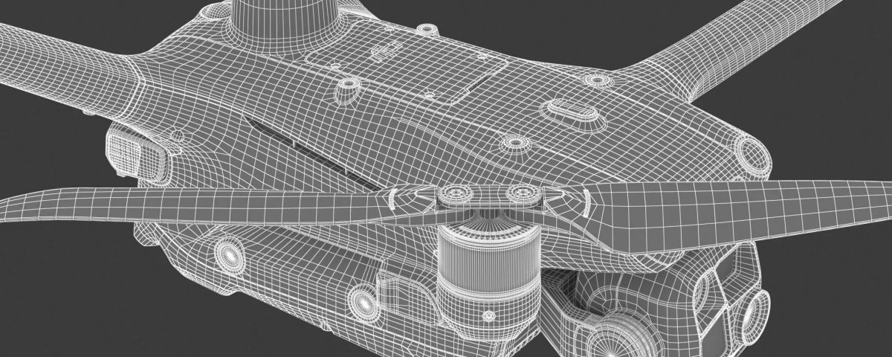

<!-- esasim: cover -->

<!-- /esasim: cover -->

<!-- Banner: upload a picture named banner.png under Data › Readme pictures (a mesh preview works well), then:  -->

# Image to Mesh Generation

**Photos in, 3D meshes out: one photo per mesh, or up to four views of one object fused into a single mesh, made on your own NVIDIA GPU by open models.**

Drop pictures into the Mesh Studio, choose a model and a quality, press **Generate meshes**. The worker runs TripoSR or Tencent's Hunyuan3D-2 on the machine's GPU and sends back each mesh with a shaded preview, a turntable in the 3D view and download buttons for GLB, OBJ, STL and PLY.

     

## Overview

An image-to-3D model looks at a photo of an object and predicts its whole shape, including the sides the camera cannot see. Before that, the background is removed so only the object is left. The predicted shape is turned into a triangle mesh, cleaned (loose fragments and broken faces removed, the face count capped), stood on the ground and exported.

With **one photo**, the hidden sides are the model's best guess. With **several photos of the same object** from the front, left, back and right, Hunyuan3D-2 multi-view fuses them into one shape that follows what each side really looks like.

The models and their code are downloaded once onto the machine and run there. The pictures and the meshes stay on your machine until the results are uploaded to EsaSim.

## Flows

### 1 · Image to mesh studio

[**Open the blueprint →**](https://esacode.com/app/projects/18/flows/59)

| Block | What it does |
|---|---|
| **START HERE · Pictures, model, Generate meshes** | The Mesh Studio. Add pictures, choose the model and the quality, press **Generate meshes**. Shows the live progress, a preview of every mesh and its download buttons. |
| **Mesh generator** | Runs the chosen model on the GPU and writes the meshes, previews, table and metadata. |
| **Interactive 3D mesh viewer** | Turn, zoom and inspect each mesh, one at a time. |
| **Batch mesh details** | Vertices, faces, colour, watertightness and time of every mesh. |

## The models

| Model | Pictures | Result | Time on an RTX 3070 (8 GB) | Licence |
|---|---|---|---|---|
| **Hunyuan3D-2 mini** (Tencent, 0.6B) · default | one per mesh | detailed shape, no colour | about 1 min per object at High quality | Tencent Hunyuan Community |
| **Hunyuan3D-2 multi-view** (Tencent, 1.1B) | 2 to 4 of one object: front, left, back, right | **one** shape fused from all the views, no colour | a few minutes per object | Tencent Hunyuan Community |
| **TripoSR** (VAST AI and Stability AI) | one per mesh | softer shape with vertex colours | a few seconds per object | MIT |

**Which one?** For the best shape of a single object, Hunyuan3D-2 mini. If you have pictures of the same object from several sides, multi-view. For a quick coloured draft, TripoSR.

**Several pictures:** when you add more than one picture, the Studio switches to **Hunyuan3D-2 multi-view**, and all the pictures become **one** mesh. Each picture gets a side (front, left, back, right) and an object name. Pictures with the same object name are fused, and every object needs a front. Multi-view takes **at most one picture per side**, so pictures beyond four are marked **not used** and greyed out. Pick which ones count with the drop-down under each picture. File names such as `chair_front.png` and `chair_left.png` fill in the side and the object by themselves. To make a separate mesh from every picture instead, choose Hunyuan3D-2 mini or TripoSR.

## Where it runs

- **NVIDIA GPU** only, with at least 6 GB of memory: the generator goes only to machines that have one. On smaller GPUs, Hunyuan3D-2 decodes the shape in smaller chunks.
- The model code runs in its own process, with the library versions it was written for (Transformers 4.45), installed in the worker's cache. The rest of the worker is left untouched.

## What you need

- A machine with the EsaSim worker and an NVIDIA GPU (Project › Compute).
- Internet access the first time, for:
  - the model code from GitHub;
  - its libraries (a few minutes);
  - the weights from Hugging Face: TripoSR about 1.7 GB, Hunyuan3D-2 mini about 2 GB, multi-view about 4 GB.

  Later runs reuse them.
- Git on the machine.
- No account or key: all three models are public on Hugging Face.

## How to run it

1. Under **Compute**, check that a machine with an NVIDIA GPU is available for this project.
2. Open [**1 · Image to mesh studio**](https://esacode.com/app/projects/18/flows/59) and press **Run** once. This run generates nothing; it opens the latest Mesh Studio. Then switch to **View**.
3. **Pictures**: drop or choose PNG, JPEG or WebP images, with:
   - one object, centred and filling most of the picture;
   - a plain background.

   A PNG that is already cut out keeps its transparency.
4. Check the **Model** (and, for multi-view, each picture's side), choose a **Quality**, and press **Generate meshes**.
5. Follow the progress in the View. The first run on a machine installs and downloads the model first. When it ends, the meshes appear under **3 · Meshes**, in the 3D view and in the details table.

Your pictures and choices stay in the Studio after each run, so you can change a setting and generate again. A new run can start once the previous one has finished.

**How the pictures travel:** they go inside the run's own settings, so they reach the machine as soon as the run starts. You can close the View once the run has started. EsaSim limits how much a run's settings can hold, so all the pictures together are sent as at most about 48 kB:
- one or two pictures go at 512 px, which is about the size the models work at;
- four pictures go at roughly 350 to 450 px each.

## Settings worth knowing

In the Mesh Studio:

- **Model**: as above.
- **Quality**:

  | | Hunyuan3D-2 | TripoSR (surface grid) |
  |---|---|---|
  | **Fast** | turbo model, 5 steps, coarser grid, up to 40,000 faces | 192 |
  | **Balanced** | 30 steps, up to 80,000 faces | 256 |
  | **High** | 50 steps on a finer grid, up to 150,000 faces | 320 |

- **Variations per object** (Hunyuan3D-2): extra shapes of the same object from different seeds, to choose the best.

On the **Mesh generator** block in the Blueprint:

- **Seed**: the same seed, pictures and settings give the same shape again.
- **Mesh formats**: any of `glb,obj,stl,ply`. GLB is always made.
- **Run without the View**, **Image links** (one link per line) and the **Images** input: for batch work. With Run without the View on, a normal Blueprint **Run** generates meshes from the links or the wired pictures. With it off, only the Studio's Generate button generates.

## What you get

- **Meshes**: `<object>.glb`, plus `.obj`, `.stl` and `.ply`. With variations, `<object>_v1.glb` and so on. Each mesh is centred and stands on the ground (y = 0), with Y up and the front facing +Z (the glTF convention). It is about one unit tall: the scale is arbitrary.
- **Previews**: `<object>_preview.png`, a shaded three-quarter view of the mesh. It is drawn in colour for TripoSR.
- **Mesh inventory** (`models.csv`): for every mesh, the pictures and sides it came from, the variation, vertices, faces, whether it is watertight, colour, height, seconds and file names.
- **generation.json**: the model, quality, settings, seed, GPU, total time and licences, to make the same meshes again.

In the Studio, every mesh card has its preview, its numbers and **↓ GLB / OBJ / STL / PLY** buttons that save the file to your computer.

## Models and licences

- **TripoSR**, [huggingface.co/stabilityai/TripoSR](https://huggingface.co/stabilityai/TripoSR), code at [github.com/VAST-AI-Research/TripoSR](https://github.com/VAST-AI-Research/TripoSR): MIT.
- **Hunyuan3D-2 mini**, [huggingface.co/tencent/Hunyuan3D-2mini](https://huggingface.co/tencent/Hunyuan3D-2mini), and **Hunyuan3D-2 multi-view**, [huggingface.co/tencent/Hunyuan3D-2mv](https://huggingface.co/tencent/Hunyuan3D-2mv), code at [github.com/Tencent-Hunyuan/Hunyuan3D-2](https://github.com/Tencent-Hunyuan/Hunyuan3D-2): Tencent Hunyuan 3D 2.0 Community License. It **does not cover use in the European Union, the United Kingdom or South Korea**, and very large commercial users need a separate licence from Tencent. Read the licence on the model page before using the meshes.
- Background removal uses **rembg** (U²-Net): MIT.
- The code of the blocks is EsaSim's.

## Notes

- These are visual meshes, not measured CAD. They may not be watertight or manifold, so check them before 3D printing or simulation.
- Thin, open structures are the hardest case. Examples are frames, wires, chair legs and car body shells. From one photo they tend to come out thickened or partly closed. Several views with multi-view and **High** quality help the most.
- Hidden sides are guessed. Hunyuan3D-2 makes shape only. TripoSR adds colours, with a softer surface.
- The first run on a machine takes several minutes longer: it installs the libraries and downloads the code and weights.

<!-- esasim: files of the project -->

---

An [EsaSim](https://esacode.com/) project of the workspace Gianluca De Novi's workspace (generative-ai).

### Blueprints in this repository

- [1 · Image to mesh studio](blueprints/1-image-to-mesh-studio.json) · 4 blocks · version 23

### Workspace blocks it uses

- [Image to mesh generator](blocks/ws-image-to-mesh-generator) · version 14
- [Image to Mesh Studio](blocks/ws-image-to-mesh-studio) · version 12

### Assets

The files the project's views draw with (3D models, textures, sounds), in [assets/](assets/):

- [textures/esacode-logo.png](assets/textures/esacode-logo.png) · 25 KB

Keys pasted in blocks (secret settings) are not saved here, nor are the team and the results of runs.
